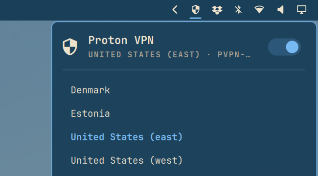

# pvpn

A VPN switch for your Omarchy top bar. Turn Proton VPN on and off, and pick a country, in one click.

Works with Proton VPN. Unofficial, not affiliated with Proton AG.



> [!CAUTION]
> **No kill switch.**
> If the VPN drops, your traffic goes out over your normal connection until it reconnects. You can check for leaks at [dnsleaktest.com](https://dnsleaktest.com). If the test shows your real IPv6 address, see [Advanced > DNS](#dns) to turn off IPv6 on the VPN connection.

## Get started

You need [Omarchy](https://omarchy.org) and a Proton VPN account. The three steps take about 5 minutes, and you'll paste a few commands into a terminal.

### 1. Download your config files

Proton gives you one small settings file per server (a WireGuard file). WireGuard is the fast VPN technology the connection uses.

- Sign in at [account.protonvpn.com](https://account.protonvpn.com).
- Go to **Downloads → WireGuard configuration** ([Proton's guide](https://protonvpn.com/support/wireguard-configurations)).
- Pick a server and download its `.conf` file.
- Get one file per location you want. They'll land in your Downloads folder.

**Keep these files private: they hold your key.**

### 2. Import them

Each connection needs a short name that starts with `pvpn-`, such as `pvpn-dk` for Denmark. Names can be at most 15 characters.

Proton's file is named something like `DK-123.conf`. For that file, run:

```bash
nmcli connection import type wireguard file ~/Downloads/DK-123.conf &&
nmcli connection modify DK-123 connection.id pvpn-dk connection.interface-name pvpn-dk connection.autoconnect no
```

- **Repeat for each file.** Run it again for every file you downloaded, swapping in that file's name and a short name of your choice.
- **Names with extra words:** `pvpn-us-east` shows in the menu as "United States (east)", which helps when you have two in the same country.

Then clean up. First list the files. Then delete each one you recognise by name:

```bash
ls ~/Downloads/*.conf
shred -u ~/Downloads/DK-123.conf
```

This deletes the downloaded files. Your connections keep working.

### 3. Install the bar icon

```bash
git clone https://github.com/allandehn/pvpn.git
cd pvpn
less install.sh      # read it first, it's short
./install.sh
```

Reading it first is a good habit with any install script.

The script restarts the bar for you. Then the shield appears in your top bar.

That's it. Click the shield.

Shield not showing? Run `omarchy-restart-shell`. Can't connect? See [Good to know](#good-to-know).

## Using it

- Click the shield to open the panel.
- The switch at the top turns the VPN on or off.
- Click a location to switch to it.
- Click the one you're on to reconnect.
- Right-click the shield to turn the VPN on or off. Middle-click refreshes.
- Hover the shield to see which location you're on.
- It starts up the way you left it: on with the same location, or off.
- The shield fades in and out while connecting. A notification tells you how it went.
- Keys in the panel: `hjkl` or arrows to move, `Enter` to pick, `t` to toggle, `r` to reconnect, `Esc` to close.

## Good to know

- **It needs NetworkManager**, the part of Linux that manages your connections. Omarchy has it.
- **Which locations you get depends on your Proton plan.** The free plan has a limited choice of servers.
  Check [Proton's site](https://protonvpn.com/pricing) for what your plan includes.
- **It doesn't touch your other connections.** Only connections named `pvpn-*` are changed.
- **Turn off other VPN apps first, including their kill switch, or they can block this one.**
- **Lost a device, or think a key leaked?** Revoke that configuration at account.protonvpn.com.

## Removing it

From the cloned `pvpn` folder:

```bash
./uninstall.sh
```

Your VPN connections stay. To remove them too, see [Advanced > Removing everything](#removing-everything).

---

## Advanced

### Command line

The bar runs `pvpn` for every change, so the bar and the terminal behave the same. `install.sh` installs both.

| Command | What it does |
|---|---|
| `pvpn` or `pvpn menu` | Pick a connection from a menu (Walker, or fzf) |
| `pvpn status` | Connected connection and startup connection |
| `pvpn list` | Your `pvpn-*` WireGuard connections |
| `pvpn up pvpn-dk` | Connect, check, roll back on failure (and make it the startup connection) |
| `pvpn reconnect NAME` | Reconnect |
| `pvpn toggle` | Off, or back on with the last used connection |
| `pvpn down` | Disconnect (and turn off autoconnect on all `pvpn-*` connections) |
| `pvpn boot [NAME\|none]` | Show or set the connection used at startup. Normally automatic: startup follows your last state. |
| `pvpn --version` | Show the version |

pvpn makes no network requests except a ping to Cloudflare (1.1.1.1) through the tunnel after connecting, to check that it carries traffic.

### Settings

Set these in the shell's environment:

- `PVPN_REDUCED_MOTION=1`: a still, dimmed icon instead of the fade while connecting.
- `PVPN_NOTIFY_ICON=<icon name>`: adds an icon to the notifications, for example `network-vpn-symbolic` if your theme has it.

### DNS

Optional. pvpn works without this. Filtering DNS reduces exposure to known malicious sites; it is not a firewall or antivirus.

DNS is how your computer turns a name like `example.com` into an address. Whoever answers those lookups can see which sites you visit.

| | Who can see your lookups | Who filters | Needs sudo? |
|---|---|---|---|
| **1. VPN on + NetShield** (recommended) | Proton only | Proton | No |
| **2. VPN on + public resolver** | Quad9 or Cloudflare (they see Proton's IP, not yours) | Quad9 or Cloudflare | No |
| **3. VPN off + encrypted DNS** | Quad9 or Cloudflare (your ISP sees the sites' IP addresses and usually site names, not your lookups) | Quad9 or Cloudflare | Only for the system-wide option |

#### 1. VPN on + NetShield (recommended)

Use this if you want the most private setup with nothing extra to set up.

Proton's config files already send DNS to Proton's own resolver inside the tunnel (`DNS = 10.2.0.1` in the `.conf`). NetShield is Proton's filter on that resolver, so your lookups stay with Proton and no extra company is involved.

Pick the level under *VPN options* when you create the config ([guide](https://protonvpn.com/support/wireguard-configurations), [NetShield](https://protonvpn.com/support/netshield)):

- **Block malware only**
- **Block ads, trackers, and malware**

The level is baked into each config. To change it, download a new config and import it again. NetShield needs a paid Proton plan.

#### 2. VPN on + a public resolver

Use this if you'd rather trust Quad9 or Cloudflare than Proton with your lookups.

Set it **only on the `pvpn-*` connection**. Replace `pvpn-XX` with your connection, for example `pvpn-dk`:

```sh
# Quad9 example (IPv4 + IPv6)
nmcli connection modify pvpn-XX ipv4.dns 9.9.9.9 ipv4.ignore-auto-dns yes ipv4.dns-priority -50
nmcli connection modify pvpn-XX ipv6.dns 2620:fe::fe ipv6.ignore-auto-dns yes ipv6.dns-priority -50
# ...or, if you don't use IPv6 on the tunnel:
# nmcli connection modify pvpn-XX ipv6.method disabled
nmcli connection down pvpn-XX; nmcli connection up pvpn-XX    # reconnect to apply
```

`dns-priority -50` makes the tunnel's DNS win over your Wi-Fi's. Without it, your computer may still ask your ISP's resolver, which is the classic DNS leak.

**Caveat:** the resolver you pick sees every site you look up. The lookups still go through the tunnel, so it sees Proton's IP, not yours.

| Resolver | IPv4 | IPv6 | Blocks |
|---|---|---|---|
| [Quad9](https://quad9.net/service/service-addresses-and-features/) | `9.9.9.9` | `2620:fe::fe` | Malware, phishing |
| [Cloudflare for Families](https://developers.cloudflare.com/1.1.1.1/setup/#1111-for-families) | `1.1.1.2` | `2606:4700:4700::1112` | Malware, phishing |
| [Cloudflare for Families](https://developers.cloudflare.com/1.1.1.1/setup/#1111-for-families) | `1.1.1.3` | `2606:4700:4700::1113` | Malware, phishing, adult content |

Neither blocks ads or trackers. For that, use NetShield (option 1).

Undo:

```sh
nmcli connection modify pvpn-XX ipv4.dns '' ipv4.ignore-auto-dns no ipv4.dns-priority 0
nmcli connection modify pvpn-XX ipv6.dns '' ipv6.ignore-auto-dns no ipv6.dns-priority 0
# if you disabled IPv6 instead, restore the method you had before
nmcli connection down pvpn-XX; nmcli connection up pvpn-XX
```

#### 3. VPN off: encrypted DNS

Use this if you want your ISP not to read your lookups when the VPN is off, or when it drops (pvpn has no kill switch).

Normal DNS is unencrypted, so just picking Quad9 or Cloudflare doesn't hide anything from your ISP. **DNS-over-TLS** (DoT) encrypts the lookups.

This hides which sites you look up from your ISP and moves that trust to Quad9/Cloudflare. Your ISP can still see which IP addresses you connect to, and usually the site name (SNI). For full privacy, use the VPN.

**Simpler option: per Wi-Fi network, no sudo.** Replace `"<wifi>"` with the connection name from `nmcli connection show`:

```sh
nmcli connection modify "<wifi>" ipv4.dns 9.9.9.9#dns.quad9.net ipv4.ignore-auto-dns yes connection.dns-over-tls 2
nmcli connection modify "<wifi>" ipv6.dns 2620:fe::fe#dns.quad9.net ipv6.ignore-auto-dns yes
nmcli connection down "<wifi>"; nmcli connection up "<wifi>"   # reconnect to apply
```

`#dns.quad9.net` is the server's name, which the encryption checks. `dns-over-tls 2` means "yes": always encrypt, never fall back. The downside: you set it for each Wi-Fi network. For Cloudflare, use `1.1.1.2#security.cloudflare-dns.com` and `2606:4700:4700::1112#security.cloudflare-dns.com` (or `1.1.1.3#family.cloudflare-dns.com` and `2606:4700:4700::1113#family.cloudflare-dns.com` to also block adult content).

Undo: `nmcli connection modify "<wifi>" ipv4.dns '' ipv4.ignore-auto-dns no ipv6.dns '' ipv6.ignore-auto-dns no connection.dns-over-tls -1`, then reconnect.

**System-wide option (needs sudo).** First check that your system uses systemd-resolved, or this does nothing:

```sh
ls -l /etc/resolv.conf   # must point to /run/systemd/resolve/stub-resolv.conf
```

Then create the settings file (Quad9):

```sh
sudo mkdir -p /etc/systemd/resolved.conf.d
printf '[Resolve]\nDNS=9.9.9.9#dns.quad9.net 2620:fe::fe#dns.quad9.net\nDNSOverTLS=yes\nDomains=~.\n' \
  | sudo tee /etc/systemd/resolved.conf.d/pvpn-dns.conf
sudo systemctl restart systemd-resolved
```

For Cloudflare, use `DNS=1.1.1.2#security.cloudflare-dns.com 2606:4700:4700::1112#security.cloudflare-dns.com` instead. `Domains=~.` makes these servers the default, so your Wi-Fi's ISP resolver isn't asked as well.

Good to know:

- **Hotel or café Wi-Fi login pages can break**, because strict encryption won't fall back. Remove the file temporarily (see Undo), log in, then put it back.
- **Don't turn on DNSSEC.** Quad9 and Cloudflare already check it, and turning it on can break real sites.
- **With the VPN on, check which resolver answers.** Don't assume. Run `resolvectl status`, `resolvectl query example.com` and a leak test. If Quad9 still answers while the VPN is on, that's encrypted and goes through the tunnel, so it's not an ISP leak, just a different resolver than NetShield.

Undo:

```sh
sudo rm /etc/systemd/resolved.conf.d/pvpn-dns.conf && sudo systemctl restart systemd-resolved
resolvectl status
```

#### Check it

After connecting, run `resolvectl status` (the `pvpn-XX` link should list your chosen DNS server) and a leak test at [dnsleaktest.com](https://dnsleaktest.com). Only Proton's servers or your chosen resolver should show, never your ISP's.

#### Turn off IPv6 on the VPN connection

If a leak test shows your real IPv6 address while the VPN is on, turn off IPv6 on that connection (replace `pvpn-XX`):

```sh
nmcli connection modify pvpn-XX ipv6.method disabled
nmcli connection down pvpn-XX; nmcli connection up pvpn-XX
```

To undo, set `ipv6.method` back to what it was before (`nmcli -g ipv6.method connection show pvpn-XX` shows the current value; check it before you change it).

#### Notes

- **Browser "secure DNS" bypasses all of this.** Firefox ("DNS over HTTPS") and Chromium ("Use secure DNS") can send lookups straight to their own resolver, skipping NetShield and the settings above. Check that setting in your browser.
- Through the tunnel, plain DNS is fine. DNS-over-TLS or DNS-over-HTTPS isn't needed there, because the tunnel already encrypts it.
- The resolver details above are correct as of November 2026. Check the linked pages for current behaviour.

### Safer handling of config files

- Instead of Downloads, make a private temporary folder with `tmp=$(mktemp -d) && echo "$tmp"`, then choose the temporary folder in the save dialog, or move the files there right away. Use `"$tmp/DK-123.conf"` in the import command, and afterwards `shred -u "$tmp"/DK-123.conf && rmdir "$tmp"`.
- Never keep config files in cloud-synced folders (Dropbox, Syncthing, Nextcloud, …).
- On an SSD, neither `rm` nor `shred` guarantees a real wipe. Full-disk encryption is what really protects you.
- After import, the key lives in `/etc/NetworkManager/system-connections/`, which only root can read.

### Other VPN apps

Mullvad, the official Proton app or another VPN can block the tunnel with their firewall or "lockdown" mode (Mullvad's did). Disconnect them and turn off their auto-connect and kill switch. Optionally, stop their service, for example if you no longer use Mullvad: `sudo systemctl disable --now mullvad-daemon`.

### Removing everything

Step 1 is what `./uninstall.sh` does. Steps 2 to 4 are optional and remove your VPN connections, keys and config files too. Deleting connections can't be undone.

#### 1. Remove the plugin and the command

From the cloned `pvpn` folder, read `uninstall.sh` first (it's short), then run `./uninstall.sh`. It does this:

- turns off the bar plugin (`omarchy plugin disable allandehn.pvpn`)
- deletes `~/.config/omarchy/plugins/allandehn.pvpn/`
- deletes the command at `~/.local/bin/pvpn`
- deletes the state folder `~/.local/state/pvpn/`
- restarts the Omarchy bar, so the icon disappears

It does **not** touch your VPN connections, so a running tunnel stays up. Never run an uninstaller piped from the web (`curl … | bash`). To do it by hand instead:

```bash
omarchy plugin disable allandehn.pvpn
rm -rf ~/.config/omarchy/plugins/allandehn.pvpn ~/.local/state/pvpn
rm -f ~/.local/bin/pvpn
omarchy-restart-shell
```

#### 2. Optional: remove the VPN connections

Disconnect first, then list and delete them:

```bash
nmcli connection down pvpn-dk          # if it is connected
nmcli -f NAME,TYPE connection show | grep pvpn-
nmcli connection delete pvpn-dk        # repeat for each connection
```

Deleting a connection also deletes its private key from `/etc/NetworkManager/system-connections/`.

#### 3. Optional: revoke the keys at Proton

Sign in at [account.protonvpn.com](https://account.protonvpn.com), open **Downloads → WireGuard configuration**, and revoke the configurations you made for this computer. Do this especially if it was lost or given away.

#### 4. Remove leftover config files

Any downloaded config files still around contain private keys, so delete them:

```bash
ls ~/Downloads/*.conf 2>/dev/null   # list them
shred -u ~/Downloads/DK-123.conf      # repeat for each file you recognise by name
```

#### Check that it is gone

```bash
ls ~/.config/omarchy/plugins/allandehn.pvpn ~/.local/state/pvpn ~/.local/bin/pvpn 2>&1   # expect "No such file"
nmcli -f NAME connection show | grep pvpn- || echo "no pvpn connections left"
sudo ls /etc/NetworkManager/system-connections | grep -i pvpn || echo "no stored keys left"
ip link | grep -i pvpn || echo "no tunnel up"
```

### Manual install

```bash
mkdir -p ~/.config/omarchy/plugins/allandehn.pvpn
cp manifest.json Panel.qml ~/.config/omarchy/plugins/allandehn.pvpn/
install -m 755 bin/pvpn ~/.local/bin/pvpn      # required: the plugin calls it
omarchy plugin enable allandehn.pvpn
omarchy-restart-shell                          # required: plugin edits only load after a restart
```

Requirements: Omarchy with its Quickshell bar (plugin support), NetworkManager with WireGuard and `nmcli`, a Nerd Font (Omarchy's default works) and `notify-send` (libnotify).

### How it works

- No Proton app, no background service, no polling. It listens to `nmcli monitor` and only runs `nmcli` when something changes.
- A switch counts as connected only after NetworkManager says so and a ping to Cloudflare (1.1.1.1) through the tunnel works, with retries for up to about 10 seconds. If it fails, the previous connection comes back, or it stays off.
- The import command in Get started sets autoconnect off, so a newly imported connection doesn't switch itself on at boot before you've used pvpn. After that, pvpn turns autoconnect on or off to match how you left it. That's how startup follows your last state.
- Startup follows the last state: connecting sets `autoconnect=yes` on that `pvpn-*` connection only and `no` on the others. Turning it off sets `no` on all of them. The last connection is saved in `~/.local/state/pvpn/last`.
- Names: the repo and command are `pvpn`, the Omarchy plugin id is `allandehn.pvpn`, and the connections are `pvpn-<country>`.

## Licence

MIT, see [LICENSE](LICENSE).

"Proton" and "Proton VPN" are trademarks of Proton AG and are used here only to describe what this tool works with. Unofficial community project, not affiliated with, endorsed by or supported by Proton AG.
